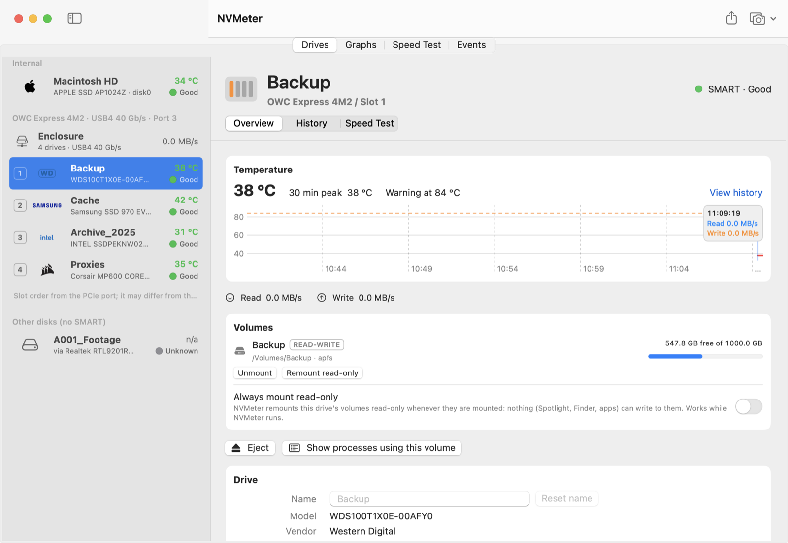
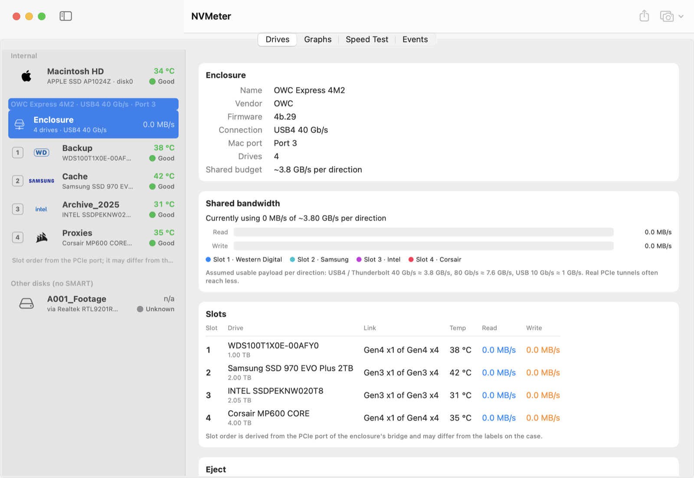
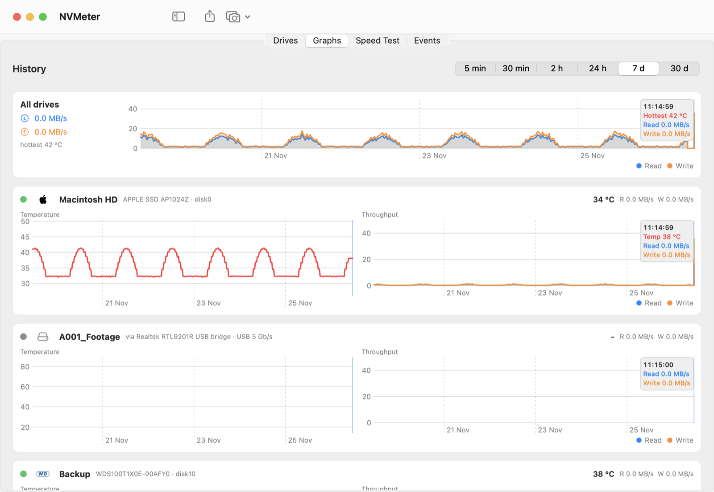
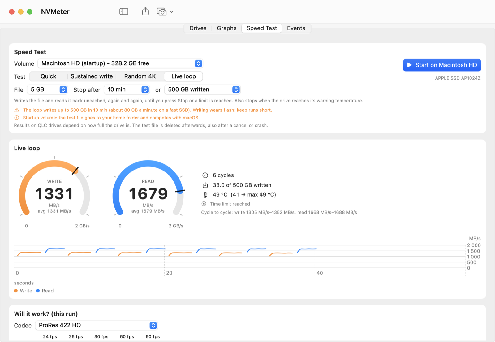
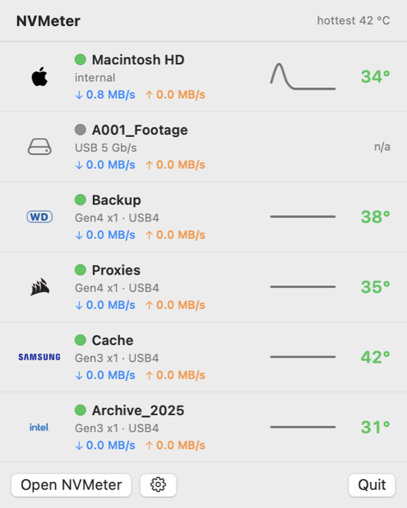

# NVMeter

[](https://github.com/petrochen/nvmeter/actions/workflows/ci.yml)
[](https://github.com/petrochen/nvmeter/releases/latest)
[](LICENSE)

NVMeter watches the SSDs on your Mac and the enclosures they sit in. It was built for people who live off external
drives: shoots that land on a four-bay enclosure, proxies on one stick, an archive on another, client media that
should never be written to by accident.

It tells you whether a drive is healthy and how hot it runs. It shows which slot of the enclosure each drive sits in
and what that slot's link can carry, and why a copy is slow. It also remembers what happened to a drive while it was
plugged into someone else's Mac.

It is a native Mac app (Swift, SwiftUI), free and open source under the MIT license. It needs no sudo, no
kernel extension and no helper, and reads everything through public macOS APIs.



## Why another disk app

On Windows I had CrystalDiskInfo for drive health and CrystalDiskMark for speed, and that was it. On the Mac the
same job took a pile of tools. Blackmagic Disk Speed Test or AJA System Test told me whether a drive could record
ProRes. AmorphousDiskMark gave the benchmark numbers, DriveDx or `smartctl` in Terminal showed SMART, iStat Menus
put temperatures in the menu bar. To find out which PCIe link a drive in the enclosure actually got I had to dig
through System Information, and Activity Monitor showed only total disk traffic. None of them knew about the four-bay
enclosure on my desk, and none remembered what a drive went through last week.

If you searched for "CrystalDiskInfo for Mac" or a Mac alternative to CrystalDiskMark or Blackmagic Disk Speed Test,
this is the app I wanted:

| You reach for | to see | In NVMeter |
| --- | --- | --- |
| CrystalDiskInfo (Windows only), DriveDx, `smartctl` | SMART health, temperature, wear, TB written | Drives tab, alerts, connect checks, history |
| CrystalDiskMark, AmorphousDiskMark | sequential and random 4K speed | Speed Test: quick, sustained write, random 4K |
| Blackmagic Disk Speed Test, AJA System Test | whether a drive keeps up with a video format | Live loop with write / read dials and a resolution by frame rate grid per codec |
| iStat Menus | drive temperatures at a glance | menu bar item and popover |
| System Information, `ioreg` | the PCIe link and USB4 / Thunderbolt / USB mode a drive got | Enclosure view with per-slot links and the shared bandwidth |
| Activity Monitor | which disk is busy | MB/s per drive and per enclosure, with history |
| Disk Utility | unmounting and mounting | unmount without ejecting, read-only mounts |

NVMeter is not affiliated with any of these products; their names are trademarks of their owners.

## What you get

### Health at a glance

Every drive gets a verdict and its temperature against the drive's own warning and critical limits (not a generic
70 °C). You also see wear, terabytes written, power-on hours, media errors and every NVMe SMART field with a status
dot. Vendor logos and your own names for drives ("A-cam", "Proxies") make a desk full of identical sticks readable.
Hold ⌘ to see a number next to each drive. ⌘0 always jumps to the Mac's own SSD, and ⌘1 to ⌘9 to the others in
sidebar order; the Drives menu lists them too.

### The enclosure as one thing

Drives are grouped by how they connect: internal, each USB4 / Thunderbolt / USB enclosure with the Mac port it is
plugged into, and other disks. For each slot you see the PCIe link it got ("Gen4 x1 of Gen4 x4" is normal for
four-bay enclosures) and the enclosure's shared bandwidth, with live bars. When a copy crawls, the hints tell apart
an enclosure that is saturated from a slot that hit its own link limit. If an enclosure falls back from USB4 to plain
USB (a bad cable, a wrong port, a switch on the case), NVMeter says so right away. SMART disappears in that mode and
speed drops to about 1 GB/s.



### History you can scroll back through

Temperature and read / write speed are kept for 30 days (up to 2 years at hourly resolution) in a small local
database. You can zoom from 5 minutes to 30 days and hover to read exact values. Each drive gets written-per-day
figures, a lifetime projection from its own pace, and the count of errors that appeared since NVMeter first saw it.



### A check every time a drive comes back

When a drive connects, NVMeter compares it with the last time it saw it. You learn how long it was away, how much was
written and read on another machine and how many hours it ran there. New errors, wear, lost spare and a slower
connection show up as well. Unsafe shutdowns are counted with context: many enclosures cut power even after a clean
eject, so NVMeter remembers whether you ejected first and only warns when the drive was pulled while mounted. Every
check saves a SMART snapshot, so "what changed since March" is one compare away.

### Speed tests that answer production questions

Quick (5 GB write and uncached read), sustained write that finds the point where the SLC cache runs out, random 4K,
and a live loop that writes and reads again and again with two dials until you stop it or it hits a time, size or
temperature limit. Results turn into a resolution by frame rate grid per codec: ProRes 422 to 4444 XQ, BRAW,
uncompressed. It tells you whether the drive can record it and whether it can play it back.



### Volumes you control

Unmount a volume without ejecting the drive (it stays powered, SMART stays visible) and mount it again later. Remount
a volume read-only before handing it to an ingest station, or set a drive to always mount read-only. That is useful
for archives and for client media. If an app holds files open, NVMeter lists which ones instead of failing silently.

### In the menu bar



The menu bar shows the hottest drive; the popover lists every drive with link, speed and a short temperature
trace. Alerts cover overheating, SMART counters getting worse, a slower PCIe link, a USB fallback, a degraded RAID set
and an always-read-only drive that could not be protected. With the window closed NVMeter uses about 1 % of one CPU
core (numbers below). It can start at login.

### Reports for warranty claims and resale

One click gives a PDF, Markdown or JSON report of a drive with charts, serial number hidden if you want. Use it for an
RMA, a resale listing or a forum thread.

<br clear="right">

### Ask your AI agent about your drives

NVMeter ships an MCP server and an agent skill for Claude Code and Codex. Ask "why is my copy to the enclosure slow?"
or "can this drive record 6K BRAW?" and the agent gets compact, joined answers from NVMeter instead of raw output from six command line tools,
plus what only NVMeter knows: history, events, connect checks and snapshots. Anything that writes or unmounts needs your explicit yes. Details in
[For AI agents](#for-ai-agents-mcp).

### Also

SATA SMART for drives behind Thunderbolt and PCIe SATA controllers (it never wakes sleeping hard drives), AppleRAID
set status, the NVMe self-test log, light and dark mode, and a "hide serial numbers" switch for screenshots.

## Install

Download `NVMeter-<version>.zip` from [Releases](https://github.com/petrochen/nvmeter/releases/latest), unzip it and
move NVMeter to Applications. Or with Homebrew:

```bash
brew trust petrochen/tap      # Homebrew asks once before loading casks from a third-party tap
brew install --cask petrochen/tap/nvmeter
```

The app is universal (Apple silicon and Intel), needs macOS 14 or later, and is signed with Developer ID (ESCUDIX
LTD) and notarized by Apple, so it opens like any other app. Allow notifications if you want alerts. NVMeter offers
to start at login on first launch, since connect checks and history are only recorded while it runs. To build it
yourself, see [Build and run](#build-and-run).

## Read-only, no privileges

Apart from the Speed Test and the mount buttons (which you start yourself, see below) NVMeter never writes to a disk
or changes its state. It needs no sudo,
no kernel extension and no helper, and never runs `smartctl`, `iostat`, `diskutil` or Python (the only external
tool is `lsof`, to show which apps keep a volume busy when it cannot be ejected). Everything comes from public
macOS APIs:

| What                                                          | Source                                                                                                              |
| ------------------------------------------------------------- | ------------------------------------------------------------------------------------------------------------------- |
| SMART / health log, Identify (warning / critical temperature) | `IONVMeSMARTInterface` (IOCFPlugIn, `kIONVMeSMARTUserClientTypeID`), the same interface smartmontools uses on macOS |
| Throughput                                                    | IORegistry `IOBlockStorageDriver` -> `Statistics`, differenced every second (decimal MB/s)                          |
| PCIe link                                                     | `IOPCIExpressLinkStatus` / `IOPCIExpressLinkCapabilities` on the NVMe PCI function                                  |
| Enclosure / USB4 / USB                                        | IORegistry Thunderbolt switch (`Thunderbolt Entry ID` on the bridge above the drive) and `IOUSBHostDevice`          |
| SATA / ATA SMART                                              | `IOATASMARTInterface` (IOCFPlugIn) on drives behind Thunderbolt / PCIe SATA controllers                            |
| RAID                                                          | IORegistry `AppleRAIDSet` / `AppleRAIDMember`                                                                       |
| Volumes                                                       | IORegistry descendants of the whole-disk `IOMedia` + DiskArbitration (APFS physical store -> container -> volumes)  |

If an enclosure falls back to USB, macOS exposes no SMART for the drive. NVMeter still lists the disk with
throughput and shows a warning such as `Connected at USB 10 Gb/s: SMART unavailable, expect ~1 GB/s`.

### Not pure Swift: small C shims

`Sources/CNVMe` (small C files) wraps Apple's COM-style `IONVMeSMARTInterface` and `IOATASMARTInterface` vtables.
Swift cannot import the `CFUUIDGetConstantUUIDWithBytes` macros or call the CFPlugIn COM interface cleanly. The shim
only opens the plug-in and issues read-only calls (SMART data, Identify, log pages); all parsing and logic is Swift.
The SMART client is opened for each read and closed right away: macOS allows only one open client per device, so
holding it would lock out `smartctl`, DriveDx or a second NVMeter.

## For AI agents (MCP)

`NVMeter --mcp` is a [Model Context Protocol](https://modelcontextprotocol.io) server over stdio, built into the same
binary. It gives an agent compact, joined answers instead of six tools' raw output (`list_drives` for six drives is
about 4 KB versus 33 KB for `--dump`), plus what only NVMeter has: history, events, connect checks and SMART snapshots.

```sh
claude mcp add --scope user nvmeter -- ~/Applications/NVMeter.app/Contents/MacOS/NVMeter --mcp
```

| Tool | What it returns |
| ---- | --------------- |
| `list_drives` | every drive in one line each: health, temperature vs its limits, wear, TB written, errors, unsafe shutdowns, enclosure and slot, link, volumes (read-only state), MB/s, warnings, latest connect check |
| `drive_details` | all SMART fields, limits, link, usage trends (written per day, lifetime projection), connect check, recent speed tests |
| `history` | temperature and MB/s over 1 h to 30 d with min / max / average |
| `events` | alerts and connect checks |
| `enclosures` | shared bandwidth budget, per-slot link, ceiling and current MB/s |
| `compare_snapshots` | SMART snapshot vs snapshot or now, with deltas per day |
| `drive_report` | the shareable report as Markdown or JSON |
| `speed_test` | writes: quick, random, live or sustained test (needs `confirm: true`) |
| `volume` | unmount, mount, read-only / read-write remount (needs `confirm: true`) |

Serial numbers are hidden unless `include_serials` is set. The two state-changing tools only describe what they would
do until they are called with `confirm: true`, which the agent should send only after the user agreed; the internal
drive and system volumes are refused. Every call takes a fresh 1 s sample (about 1.1 s); history needs the app to have
been running. Speed tests run from MCP are not added to the app's history.

### Agent skill (Claude Code, Codex)

`skills/nvmeter` is a skill for Claude Code and Codex: when to use NVMeter, recipes for the usual questions (health,
slow copies, throttling, video work, warranty reports, protecting archives), how to read SMART and enclosure numbers
(`references/reading-smart.md`) and the safety rules. `make install-skill` copies it to `~/.claude/skills` and
`~/.codex/skills`. Codex MCP: `codex mcp add nvmeter -- ~/Applications/NVMeter.app/Contents/MacOS/NVMeter --mcp`.

## Footprint

Measured on an M-series Mac with six disks (five NVMe), 60 s each, `ps` CPU time and `top`:

| State | CPU (one core) | Idle wake-ups / s | Memory |
| --- | --- | --- | --- |
| Menu bar only (window closed) | ~1 % | ~1 | ~80 MB |
| Window open, Drives tab | ~5 % (SwiftUI redrawing the live charts) | ~5 | ~330 MB |
| Sampling alone (`--record`) | ~0.7 % | - | ~20 MB |
| `--mcp` server, idle | 0 % (blocked on input) | 0 | ~15 MB |

Throughput counters are read every second (cheap), SMART every 5 s by default (Settings), volume lists only when
DiskArbitration reports a change or once a minute. The window's content is not built while it is closed, minimised or
fully covered, and the menu bar item is redrawn only when its text changes. Only one app instance runs; SMART reads of
all NVMeter processes (app, MCP servers, CLI) take turns through a lock file.

## Build and run

Requires Xcode 26+ command line tools (Swift 6 toolchain), macOS 14+.

```sh
make build      # swift build -c release
make app        # assembles build/NVMeter.app, strips xattrs, ad-hoc codesigns
make run        # make app + open it
make dump       # make app + print the JSON dump
```

### CLI mode

```sh
build/NVMeter.app/Contents/MacOS/NVMeter --dump
```

prints one JSON document with everything the app knows about every disk (SMART fields, link, connection,
volumes, a 2 second throughput sample, health rows) and exits. Useful for verification and scripting.

`--hide-serials` (also a Settings toggle) masks serial numbers in the UI and the dump, so output can be shared.

`NVMeter --screenshot <dir> [--appearance dark|light] [--warmup 60]` renders the app window into PNG files
(with a simulated hover crosshair on the Graphs tab) and quits. Needs no Screen Recording permission. `--demo-names` replaces volume names and
mount points with neutral ones (with `--hide-serials`, screenshots carry nothing of the machine); the README
screenshots were made with `--hide-serials --demo-names --db <scratch.sqlite> --seed-demo`.

## History store

Samples and hourly SMART snapshots are kept in `~/Library/Application Support/NVMeter/history.sqlite` (WAL):
1 s resolution for 2 h, 1 min for 30 days, 1 h for up to 2 years (Settings: keep 30 d / 90 d / 2 y, delete history).
Drives are keyed by model + serial (registry path for drives without SMART / behind a USB bridge), so history and
custom names survive reconnects. Hidden CLI modes: `--dump-db-stats`, `--set-name <key> <name>`, `--reset-name <key>`,
`--record <seconds>` (headless sampling), `--compact`, `--db <file>` (any mode). `--seed-demo` (screenshot mode, needs
`--db`) fills a throwaway database with synthetic history.

## Drive reports and snapshots

**Reports** answer "show me the state of this drive": warranty claims, selling a drive, handing media to a client,
forum posts and issue trackers. Drives tab: toolbar button "Export Report..." (also File > Export Report, Cmd+Shift+E).
The sheet picks PDF (one A4 or Letter page per drive, with a temperature and a throughput chart), JSON or Markdown,
and can hide the serial number and the volume names / mount points.

```sh
NVMeter --report <diskN|all> --format pdf|json|md --out <path> [--hide-serials] [--hide-volumes] [--paper a4|letter]
```

The CLI takes a short ~6 s live sample for the charts (the app uses its in-memory history of the last 30 min).
Content: date, app version, Mac model and macOS, drive identity (vendor, model, serial, firmware, capacity, NVMe
version), connection (interface, link current / max, enclosure and its firmware), health verdict with reasons, every
SMART field with its status, totals (TB written / read, power-on hours, power cycles, unsafe shutdowns, media and
error-log counts), temperature thresholds and the volumes.

JSON schema (`schemaVersion` 1): `{schemaVersion, generatedAt (ISO 8601), app{name,version}, machine{model,macOS},
options{serialsHidden,volumesHidden}, drives[]}`; each drive has `identity`, `connection{kind,interface,link,enclosure}`,
`health{verdict,reasons[]}`, `smartAvailable`, `warnings[]`, `smartFields[{name,value,status}]`, `counters` (raw numbers),
`temperature`, `volumes[]` and `charts{windowSeconds,temperature[],throughput[]}`. New fields may be added without a
version bump; removals or renames bump `schemaVersion`.

**Snapshots** store the full SMART state of a drive as a plain JSON file in
`~/Library/Application Support/NVMeter/snapshots/<drive-key>/<timestamp>.json` (the drive key is vendor / model plus a
hash of the serial, raw serials are never written). A snapshot is taken automatically the first time a drive is seen;
Drives tab > Snapshots > "Save snapshot" adds one, "Compare..." shows two snapshots (or a snapshot against now) with
before, after, delta and delta per day, worse values in red.

```sh
NVMeter --snapshot <diskN|all>
NVMeter --compare <diskN> [<snapshotA> [<snapshotB>]]   # default: latest snapshot vs now; names, unique prefixes or "now"
```

## Vendor logos and trademarks

The vendor is identified from the PCI vendor / subsystem vendor ID in the NVMe Identify Controller data,
with model-name rules first (Phison-based drives such as Corsair report the controller vendor).
Logos are monochrome SVGs from [Simple Icons](https://github.com/simple-icons/simple-icons) (CC0, see
`THIRD_PARTY/simple-icons-LICENSE.md`), bundled in `Resources/Logos` and tinted with the brand colour
(adjusted for contrast in light / dark mode): Apple, Samsung, Intel, Corsair, Seagate, Toshiba, Kingston.
Vendors Simple Icons does not have (Western Digital, WD Black, SanDisk, Solidigm, Crucial, Micron, SK hynix,
Sabrent, ADATA, XPG, Lexar, KIOXIA, TeamGroup, PNY, Hikvision) get a text badge in an approximate brand colour.
No logos are taken from vendor sites.

Brand names and logos are trademarks of their respective owners and are used only to identify hardware.
NVMeter is not affiliated with or endorsed by any of them.

## Layout

```
Sources/CNVMe              C shims around IONVMeSMARTInterface / IOATASMARTInterface
Sources/NVMeter            registry, SMART readers, drive scanner, sampler, health, monitor, main views
Sources/NVMeter/Enclosure  topology sidebar, enclosure view, bandwidth analysis, eject, volume holders
Sources/NVMeter/Store      SQLite history, drive keys, trends, recorder
Sources/NVMeter/MenuBar    menu bar item, popover, events, app lifecycle
Sources/NVMeter/Alerts     alert rules and notifications
Sources/NVMeter/Report     PDF / JSON / Markdown reports, snapshots and compare
Sources/NVMeter/SpeedTest  speed test engine, cliff detector, video format table
Resources                  Info.plist, app icon, vendor logos
scripts/make-icon.swift    draws the app icon (make icon)
Tests                      parser tests (swift test)
```

## Known limitations

- SMART needs a transparent NVMe path: USB bridges (and USB4 / Thunderbolt enclosures that fell back to USB) hide it.
- ATA SMART, RAID detection and the "don't wake sleeping hard drives" logic are implemented from Apple's headers
  and tested with synthetic data only; they have not met real SATA or RAID hardware yet.
- Slot numbers come from the enclosure's PCIe switch ports and may not match the labels on the case.
- The enclosure fan speed is not visible to macOS.
- Ad-hoc signed: on first launch use right-click > Open, and allow notifications in System Settings.
- Thunderbolt link speed is derived from the lane adapter's current speed / width; asymmetric 120 Gb/s links
  are shown as 80 Gb/s at most.

## Menu bar, alerts, launch at login

- A menu bar item shows the hottest drive temperature (optionally total MB/s); the popover lists every drive with
  link, throughput, a 5 minute sparkline and the latest events. Closing the window keeps the app running in the
  menu bar (Settings); the Dock icon only exists while a window is open.
- Alerts (Settings > Alerts, each rule has its own switch): temperature near the drive's warning threshold (offset,
  3 degree hysteresis, 30 minute cooldown), critical temperature, SMART counters getting worse, PCIe link or USB4
  fallback downgrades, and drives vanishing with mounted volumes. The last 200 events are on the Events tab.
- Connect check state lives in `~/Library/Application Support/NVMeter/connect-check.json` (last visit and latest
  report per drive). Gaps under 2 minutes are treated as reconnect blips. Checks only happen while NVMeter runs, so on
  the first launch it offers to start at login (asked once; Settings has the switch).
- `NVMeter --volume <diskNsM> unmount|mount|mount-ro|remount-ro|remount-rw` runs the same DiskArbitration calls as
  the Volumes card and prints the resulting mount state.
- `NVMeter --test-alerts` posts one test notification per rule; `--test-login-item` registers and unregisters the
  login item and prints the status of each step.

## Speed Test (the only part that writes)

The Speed Test tab (and the Speed Test section of each drive) writes a temporary file to a mounted volume you pick
(never anything else), measures Quick (5 GB sequential write and uncached read), Sustained write (SLC cache cliff
detection), Random 4K (QD1 / QD32) and Live loop (a 1 to 10 GB file written and read back uncached in a loop, with
live write / read dials and the MB/s trace; it stops after 2 to 60 minutes or 100 to 1000 GB written, whichever comes
first, and early when the drive reaches its own warning temperature), and rates the result against common video formats (approximate data rates in
`Sources/NVMeter/SpeedTest/VideoFormats.swift`). Test files live in `.nvmeter-speedtest/` and are always deleted,
stale ones at the next launch. Last results per drive are kept in Application Support.
CLI: `NVMeter --speedtest <mountpoint> --mode quick|sustained|random|live [--size GB|free10] [--seconds N] [--max-gb N]`
prints JSON (`--seconds` is the time limit of a live loop, `--max-gb` its write limit).

## Contributing

Bug reports, hardware reports and pull requests are welcome, AI-assisted ones included. Start with
[CONTRIBUTING.md](CONTRIBUTING.md); coding agents read [AGENTS.md](AGENTS.md). Questions and results go to
[Discussions](https://github.com/petrochen/nvmeter/discussions), security problems to [SECURITY.md](SECURITY.md).
Changes per version: [CHANGELOG.md](CHANGELOG.md).

## License

MIT, see [LICENSE](LICENSE). Contributions are welcome, including AI-assisted ones: see
[CONTRIBUTING.md](CONTRIBUTING.md). Bundled Simple Icons logos are CC0.
