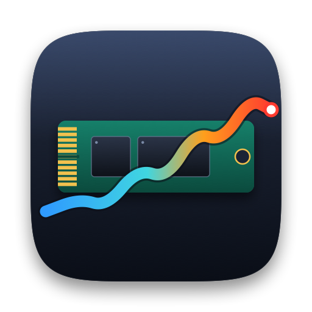

# NVMeter

A native macOS monitor for NVMe SSDs and the external enclosures they live in: "CrystalDiskInfo for the Mac,
with iStat-style graphs", built for people who work with lots of external drives (video, photo, archives).
Swift + SwiftUI + Swift Charts, one self-contained `.app`, no runtime dependencies, no sudo, no kernel extension.



- **Drives**: health verdict, temperature with the drive's own warning / critical thresholds, model, serial,
  firmware, capacity, interface (for example `PCIe 4.0 x1 via USB4 40 Gb/s, OWC Express 4M2`), every NVMe SMART
  field with a status dot, totals written / read, power-on hours, volumes, NVMe self-test log, vendor logo,
  custom drive names, and a **Usage & lifetime** section (written per day, lifetime projection, errors added since
  the drive was first seen).
- **Enclosures**: drives grouped by connection (internal, each USB4 / Thunderbolt / USB enclosure with its Mac
  port, other disks), slot numbers, the per-slot PCIe link ("Gen4 x1 of Gen4 x4"), and the enclosure's shared
  bandwidth budget with live read / write bars and "why is it slow?" hints (enclosure saturated vs slot link limit).
- **Graphs**: temperature and read / write MB/s per drive and in total, 5 min to 30 days from a local history
  database, hover crosshair with exact values.
- **Connect check**: every time a drive connects (or is found when NVMeter starts) its SMART is compared with the
  state from its previous visit: how long it was away, data written / read and hours powered on elsewhere, unsafe
  shutdowns (told apart: pulled while mounted, or an enclosure that cuts power after a clean eject), new media errors,
  wear, spare, time above the warning temperature, a USB fallback or a changed connection. The result is on the
  drive's Overview and in Events, a SMART snapshot is saved, and a notification is posted only when something needs
  attention or the drive was used elsewhere.
- **Menu bar** item with the hottest temperature and a drive list; **alerts** for overheating, SMART counters
  getting worse, a PCIe link or USB4 → USB downgrade, degraded RAID sets; an **Events** log; launch at login.
- **Reports** (PDF / JSON / Markdown) for warranty claims, resale or forum posts, and SMART **snapshots** with
  compare.
- **Speed Test** for media work: quick, sustained write with SLC-cache cliff detection, random 4K, a **live loop**
  (write and read the test file again and again, two live dials, stops on a time / write limit or at the drive's
  warning temperature), and a verdict per video format (ProRes, ProRes RAW, BRAW, H.265, uncompressed): a
  resolution x frame rate grid per codec and how many streams fit.
- **SATA / ATA SMART** for drives behind Thunderbolt / PCIe SATA controllers (without waking sleeping hard
  drives) and **AppleRAID** set status.
- Every screen works in light and dark mode; "Hide serial numbers" makes screenshots safe to share.

## Read-only, no privileges

Apart from the Speed Test (which you start yourself, see below) NVMeter never writes to a disk. It needs no sudo,
no kernel extension and no helper, and never runs `smartctl`, `iostat`, `diskutil` or Python (the only external
tool is `lsof`, to show which apps keep a volume busy when it cannot be ejected). Everything comes from public
macOS APIs:

| What                                                          | Source                                                                                                              |
| ------------------------------------------------------------- | ------------------------------------------------------------------------------------------------------------------- |
| SMART / health log, Identify (warning / critical temperature) | `IONVMeSMARTInterface` (IOCFPlugIn, `kIONVMeSMARTUserClientTypeID`), the same interface smartmontools uses on macOS |
| Throughput                                                    | IORegistry `IOBlockStorageDriver` -> `Statistics`, differenced every second (decimal MB/s)                          |
| PCIe link                                                     | `IOPCIExpressLinkStatus` / `IOPCIExpressLinkCapabilities` on the NVMe PCI function                                  |
| Enclosure / USB4 / USB                                        | IORegistry Thunderbolt switch (`Thunderbolt Entry ID` on the bridge above the drive) and `IOUSBHostDevice`          |
| SATA / ATA SMART                                              | `IOATASMARTInterface` (IOCFPlugIn) on drives behind Thunderbolt / PCIe SATA controllers                            |
| RAID                                                          | IORegistry `AppleRAIDSet` / `AppleRAIDMember`                                                                       |
| Volumes                                                       | IORegistry descendants of the whole-disk `IOMedia` + DiskArbitration (APFS physical store -> container -> volumes)  |

If an enclosure falls back to USB, macOS exposes no SMART for the drive. NVMeter still lists the disk with
throughput and shows a warning such as `Connected at USB 10 Gb/s: SMART unavailable, expect ~1 GB/s`.

### Not pure Swift: small C shims

`Sources/CNVMe` (small C files) wraps Apple's COM-style `IONVMeSMARTInterface` and `IOATASMARTInterface` vtables.
Swift cannot import the `CFUUIDGetConstantUUIDWithBytes` macros or call the CFPlugIn COM interface cleanly. The shim
only opens the plug-in and issues read-only calls (SMART data, Identify, log pages); all parsing and logic is Swift.
The SMART client is opened for each read and closed right away: macOS allows only one open client per device, so
holding it would lock out `smartctl`, DriveDx or a second NVMeter.

## Build and run

Requires Xcode 26+ command line tools (Swift 6 toolchain), macOS 14+.

```sh
make build      # swift build -c release
make app        # assembles build/NVMeter.app, strips xattrs, ad-hoc codesigns
make run        # make app + open it
make dump       # make app + print the JSON dump
```

### CLI mode

```sh
build/NVMeter.app/Contents/MacOS/NVMeter --dump
```

prints one JSON document with everything the app knows about every disk (SMART fields, link, connection,
volumes, a 2 second throughput sample, health rows) and exits. Useful for verification and scripting.

`--hide-serials` (also a Settings toggle) masks serial numbers in the UI and the dump, so output can be shared.

`NVMeter --screenshot <dir> [--appearance dark|light] [--warmup 60]` renders the app window into PNG files
(with a simulated hover crosshair on the Graphs tab) and quits. Needs no Screen Recording permission.

## History store

Samples and hourly SMART snapshots are kept in `~/Library/Application Support/NVMeter/history.sqlite` (WAL):
1 s resolution for 2 h, 1 min for 30 days, 1 h for up to 2 years (Settings: keep 30 d / 90 d / 2 y, delete history).
Drives are keyed by model + serial (registry path for drives without SMART / behind a USB bridge), so history and
custom names survive reconnects. Hidden CLI modes: `--dump-db-stats`, `--set-name <key> <name>`, `--reset-name <key>`,
`--record <seconds>` (headless sampling), `--compact`, `--db <file>` (any mode). `--seed-demo` (screenshot mode, needs
`--db`) fills a throwaway database with synthetic history.

## Drive reports and snapshots

**Reports** answer "show me the state of this drive": warranty claims, selling a drive, handing media to a client,
forum posts and issue trackers. Drives tab: toolbar button "Export Report..." (also File > Export Report, Cmd+Shift+E).
The sheet picks PDF (one A4 or Letter page per drive, with a temperature and a throughput chart), JSON or Markdown,
and can hide the serial number and the volume names / mount points.

```sh
NVMeter --report <diskN|all> --format pdf|json|md --out <path> [--hide-serials] [--hide-volumes] [--paper a4|letter]
```

The CLI takes a short ~6 s live sample for the charts (the app uses its in-memory history of the last 30 min).
Content: date, app version, Mac model and macOS, drive identity (vendor, model, serial, firmware, capacity, NVMe
version), connection (interface, link current / max, enclosure and its firmware), health verdict with reasons, every
SMART field with its status, totals (TB written / read, power-on hours, power cycles, unsafe shutdowns, media and
error-log counts), temperature thresholds and the volumes.

JSON schema (`schemaVersion` 1): `{schemaVersion, generatedAt (ISO 8601), app{name,version}, machine{model,macOS},
options{serialsHidden,volumesHidden}, drives[]}`; each drive has `identity`, `connection{kind,interface,link,enclosure}`,
`health{verdict,reasons[]}`, `smartAvailable`, `warnings[]`, `smartFields[{name,value,status}]`, `counters` (raw numbers),
`temperature`, `volumes[]` and `charts{windowSeconds,temperature[],throughput[]}`. New fields may be added without a
version bump; removals or renames bump `schemaVersion`.

**Snapshots** store the full SMART state of a drive as a plain JSON file in
`~/Library/Application Support/NVMeter/snapshots/<drive-key>/<timestamp>.json` (the drive key is vendor / model plus a
hash of the serial, raw serials are never written). A snapshot is taken automatically the first time a drive is seen;
Drives tab > Snapshots > "Save snapshot" adds one, "Compare..." shows two snapshots (or a snapshot against now) with
before, after, delta and delta per day, worse values in red.

```sh
NVMeter --snapshot <diskN|all>
NVMeter --compare <diskN> [<snapshotA> [<snapshotB>]]   # default: latest snapshot vs now; names, unique prefixes or "now"
```

## Vendor logos and trademarks

The vendor is identified from the PCI vendor / subsystem vendor ID in the NVMe Identify Controller data,
with model-name rules first (Phison-based drives such as Corsair report the controller vendor).
Logos are monochrome SVGs from [Simple Icons](https://github.com/simple-icons/simple-icons) (CC0, see
`THIRD_PARTY/simple-icons-LICENSE.md`), bundled in `Resources/Logos` and tinted with the brand colour
(adjusted for contrast in light / dark mode): Apple, Samsung, Intel, Corsair, Seagate, Toshiba, Kingston.
Vendors Simple Icons does not have (Western Digital, WD Black, SanDisk, Solidigm, Crucial, Micron, SK hynix,
Sabrent, ADATA, XPG, Lexar, KIOXIA, TeamGroup, PNY, Hikvision) get a text badge in an approximate brand colour.
No logos are taken from vendor sites.

Brand names and logos are trademarks of their respective owners and are used only to identify hardware.
NVMeter is not affiliated with or endorsed by any of them.

## Layout

```
Sources/CNVMe              C shims around IONVMeSMARTInterface / IOATASMARTInterface
Sources/NVMeter            registry, SMART readers, drive scanner, sampler, health, monitor, main views
Sources/NVMeter/Enclosure  topology sidebar, enclosure view, bandwidth analysis, eject, volume holders
Sources/NVMeter/Store      SQLite history, drive keys, trends, recorder
Sources/NVMeter/MenuBar    menu bar item, popover, events, app lifecycle
Sources/NVMeter/Alerts     alert rules and notifications
Sources/NVMeter/Report     PDF / JSON / Markdown reports, snapshots and compare
Sources/NVMeter/SpeedTest  speed test engine, cliff detector, video format table
Resources                  Info.plist, app icon, vendor logos
scripts/make-icon.swift    draws the app icon (make icon)
Tests                      parser tests (swift test)
```

## Known limitations

- SMART needs a transparent NVMe path: USB bridges (and USB4 / Thunderbolt enclosures that fell back to USB) hide it.
- ATA SMART, RAID detection and the "don't wake sleeping hard drives" logic are implemented from Apple's headers
  and tested with synthetic data only; they have not met real SATA or RAID hardware yet.
- Slot numbers come from the enclosure's PCIe switch ports and may not match the labels on the case.
- The enclosure fan speed is not visible to macOS.
- Ad-hoc signed: on first launch use right-click > Open, and allow notifications in System Settings.
- Thunderbolt link speed is derived from the lane adapter's current speed / width; asymmetric 120 Gb/s links
  are shown as 80 Gb/s at most.

## Menu bar, alerts, launch at login

- A menu bar item shows the hottest drive temperature (optionally total MB/s); the popover lists every drive with
  link, throughput, a 5 minute sparkline and the latest events. Closing the window keeps the app running in the
  menu bar (Settings); the Dock icon only exists while a window is open.
- Alerts (Settings > Alerts, each rule has its own switch): temperature near the drive's warning threshold (offset,
  3 degree hysteresis, 30 minute cooldown), critical temperature, SMART counters getting worse, PCIe link or USB4
  fallback downgrades, and drives vanishing with mounted volumes. The last 200 events are on the Events tab.
- Connect check state lives in `~/Library/Application Support/NVMeter/connect-check.json` (last visit and latest
  report per drive). Gaps under 2 minutes are treated as reconnect blips. Checks only happen while NVMeter runs, so on
  the first launch it offers to start at login (asked once; Settings has the switch).
- `NVMeter --test-alerts` posts one test notification per rule; `--test-login-item` registers and unregisters the
  login item and prints the status of each step.

## Speed Test (the only part that writes)

The Speed Test tab (and the Speed Test section of each drive) writes a temporary file to a mounted volume you pick
(never anything else), measures Quick (5 GB sequential write and uncached read), Sustained write (SLC cache cliff
detection), Random 4K (QD1 / QD32) and Live loop (a 1 to 10 GB file written and read back uncached in a loop, with
live write / read dials and the MB/s trace; it stops after 2 to 60 minutes or 100 to 1000 GB written, whichever comes
first, and early when the drive reaches its own warning temperature), and rates the result against common video formats (approximate data rates in
`Sources/NVMeter/SpeedTest/VideoFormats.swift`). Test files live in `.nvmeter-speedtest/` and are always deleted,
stale ones at the next launch. Last results per drive are kept in Application Support.
CLI: `NVMeter --speedtest <mountpoint> --mode quick|sustained|random|live [--size GB|free10] [--seconds N] [--max-gb N]`
prints JSON (`--seconds` is the time limit of a live loop, `--max-gb` its write limit).

## License

MIT
